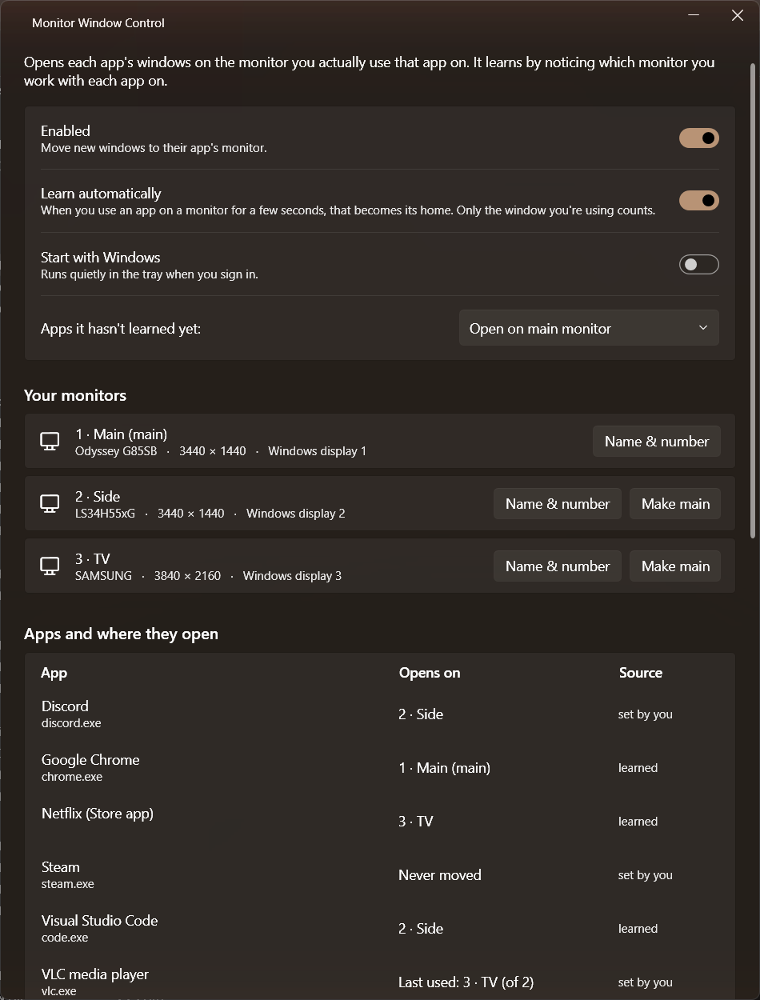

# Monitor Window Control

Monitor Window Control opens each app's windows on the monitor you actually use that app on.
It sits in the system tray, watches for new windows, and moves each one to its app's "home" monitor.
It learns homes by itself: when you use an app on a monitor for a few seconds, that monitor becomes the app's home.

<p align="center">
  
</p>

**[⬇ Download MonitorWindowControl.exe](../../releases/latest/download/MonitorWindowControl.exe)** (10 MB, Windows 10/11, no install)

## Why

With several displays, Windows often opens new windows on the wrong one. Think of a TV behind you that you
only use for streaming. Unplugging it isn't an answer, because you *do* want your streaming apps there.
Windows today either restores a window's last position or falls back to the primary monitor, and it has no
idea that an app "belongs" on a particular screen.

Monitor Window Control is a working prototype of how this could work in Windows itself:

- **A home monitor per app.** New windows open on the app's home, or on the main monitor (or another one you choose)
  while that one isn't connected or is switched off. That's temporary: it isn't learned as the new home, and the
  windows go back when the monitor does.
- **Learned, not configured.** The monitor where you actively use an app (the focused window, for a few seconds) becomes its home.
  Background windows never count, so a window forgotten on the TV can't teach it the wrong thing.
- **Easy overrides.** You can pin an app to a monitor, or mark it "never move".
- **Never fights you.** Each new window is placed once. If you move it somewhere else, it stays there.

Existing features solve different problems. "Remember window locations based on monitor connection" restores
windows when a monitor reconnects. Snap Layouts, FancyZones and Workspaces arrange windows. None of them say
which monitor an app's new windows should open on.

## Run it

1. Download `MonitorWindowControl.exe` from the [latest release](../../releases/latest) and put it anywhere you like
   (for example `C:\Tools\MonitorWindowControl\`). It's a single file that needs no installing and no admin rights.
   It uses the free [.NET Desktop Runtime](https://dotnet.microsoft.com/download/dotnet/8.0) 8 or newer, which
   many PCs already have. If yours doesn't, Windows offers to download it the first time you start the app.
2. Double-click it and its window opens. When you close the window it keeps working in the tray
   (look for the monitor-with-a-house icon, drawn in white or black to suit your taskbar; it may be under the **^**
   arrow next to the clock).
   You don't need to set anything: just use your apps, and each one is learned after a few seconds on a monitor.
   The very first time, a short welcome inside the window walks you through three steps, each of which you can skip:
   your monitors (give them numbers and names, with **Identify** to see which is which), apps that belong on a
   specific monitor (each open app has a monitor list, and a TV can be kept for **Only apps I choose**), and how it
   runs (the three choices below, with how much memory each uses, and **Start with Windows**). Then it shows the
   General page. An imported `WindowHome.ini` (see below) is already in place when the welcome starts.
3. To have it start when you sign in, turn on **Start with Windows** in its window. Apps that start with Windows too
   (a chat or music app, for example) often open before Monitor Window Control does: with **Also place apps that opened
   while signing in** (on by default), their windows are moved to their monitors right after you sign in. Windows you've
   already started using are left alone, and it never happens when you just restart Monitor Window Control later on.

Coming from the earlier AutoHotkey version (it was called WindowHome)? Put its `WindowHome.ini` in the **same folder as MonitorWindowControl.exe**
before the very first run, and Monitor Window Control imports it (homes, pinned apps, "never move" apps, and settings).
Stop the AutoHotkey script so the two don't both move windows.

Requirements: Windows 10 or 11, 64-bit. The exe isn't code-signed, so Windows SmartScreen may warn the first
time. Choose *More info → Run anyway*.

## How it runs: your choice

Something has to notice a new window to move it, because Windows has no "open this app on that monitor"
setting of its own. So you choose how much runs in the background (**How it runs**, at the top of the window):

| Mode | What runs in the background | What gets placed |
|---|---|---|
| **In the tray** (default) | The app, in the tray (about 0% CPU, ~30 MB) | Every new window. Learns where you use apps. |
| **Small background helper** | Only a small helper: no window, no tray icon (about 0% CPU, ~5 MB). The settings window runs only while it's open. | Every new window. Learns where you use apps. |
| **Nothing in the background** | Nothing at all | Only apps you open from their **launch shortcuts** (Start menu → Monitor Window Control). A helper starts with the app, places its window, and exits after a few seconds. Windows opened any other way (links, apps opening extra windows, autostart) aren't moved, and nothing is learned automatically. |

To make a launch shortcut: select an app in the list, save where it opens, then press **Create launch shortcut…**.
Choose **Open on** (*Its usual monitor*, or a monitor of its own, for example "Edge on 3 · TV" next to your usual Edge
shortcut), optionally **Open with** a web address or file (programs only, not Store apps), and its name. It appears in
Start menu → Monitor Window Control (right-click it → *Pin to taskbar* if you like); you can also put one on the desktop.
A monitor chosen for a shortcut is only used when the app is opened from that shortcut: where the app usually opens
doesn't change. An app can have several shortcuts; each one is listed under the app with **Remove**. Your existing
shortcuts are never changed. Launch shortcuts work in every mode.

## Using it

- **Tray icon** (tray mode): double-click to open the window. Right-click for *Open*, *Move new windows*
  (pause/resume), *Move open windows to their monitors*, *Bring all windows to*, *Open a group* (see App groups),
  *Monitors* (*Identify*, treat a monitor as switched off, and *Disconnect from Windows* / *Connect*, see below), *Exit*. Closing the window just puts it back in the tray (**Exit** in the window closes it completely).
  In the other modes there's no tray icon: start `MonitorWindowControl.exe` again to change settings, and closing
  its window closes it completely.
- **Always open on…** (tray mode): the top of the tray menu shows the last app you used, for example
  "Chrome · on 1 · Main". Point to it and choose a monitor, *Where I used it last* or *Never move this app*: it's saved as
  "Set by you", and its open windows move there right away. *More choices…* opens the Apps page with that app selected.
- **Move new windows**: moves new windows to their app's monitor. Turn it off to pause everything (learning too).
- **Learn automatically**: only the window you're actually using counts. If the same app stays focused on the
  same monitor for two checks in a row (about 4 seconds), that monitor becomes its home. Windows sitting in the
  background never teach it anything. Nothing is learned while only one monitor is connected, or for 30 seconds
  after monitors change (a TV switched on, waking from sleep, a game changing resolution), because then you use
  apps where they *have* to be, not where you want them. Changing the refresh rate or turning HDR on or off doesn't
  count as monitors changing. Nothing is learned while monitors are duplicated (Windows key + P → *Duplicate*) or
  during a Remote Desktop session either; the General page says so at the top. Nothing is learned on a monitor you
  treat as switched off, and apps aren't learned on a monitor kept for apps you choose. Installers and uninstallers aren't remembered.
- **While connected with Remote Desktop**: when you use this PC from another one, the other PC's monitors replace
  yours, so by default Monitor Window Control pauses until you're back (**Pause**). Choose **Keep moving windows**
  if you want windows placed anyway; learning still pauses.
- **Apps it hasn't learned yet**: open them on the main monitor, on the monitor with the mouse pointer, or leave them where Windows puts them.
- **Open dialogs on the same monitor as their app** (on by default): a Save, Print or Settings window that opens on
  another monitor than its app moves over the app's window. It's never resized. Large windows, windows that are partly on
  the app's monitor already, and dialogs of apps set to *Never move* are left alone.
- **Pause while a game or presentation is running** (on by default): while a game or any other app runs fullscreen, or
  Windows is in presentation mode, no window is moved and nothing is learned. Windows that open meanwhile are placed when it
  ends, unless you've switched to them (or they've waited more than 15 minutes). The General page and the tray icon say
  when it's paused.
- **When an app's monitor is off**: where apps open while their own monitor is disconnected or switched off: the main
  monitor (default), another monitor you choose, or where Windows puts them. Each app can have its own choice too (Apps page).
- **When a monitor comes back** (TV switched on again, waking from sleep, a dock reconnected): windows that opened on
  another monitor while it was off, and windows Windows moved off it when it went away, go back to it (**Move its windows
  back**, the default), about 3 seconds after things settle. Windows you've moved since, and windows Windows already put
  back, stay where they are; so do minimized, fullscreen and administrator windows. Choose **Leave them where they are**
  to turn this off.
- **Put windows back after sleep** (on by default): Windows often squeezes and stacks windows while monitors sleep.
  Just before the PC sleeps, Monitor Window Control notes where each window is (in memory only, nothing is saved).
  After you sign in again and the monitors are back (it waits up to a minute for all of them), windows that moved go
  back where they were. Windows you move after waking up are left alone. Windows of a monitor that isn't back yet go
  back when it is.
- **Monitor layout and Identify**: the top of the Monitors page shows how your monitors are arranged, like
  Settings → Display, with your own numbers and names and "(main)". Select a monitor in the picture to go to its
  settings. **Identify** (also under *Monitors* in the tray menu) shows each monitor's number and name in large letters
  on that monitor for 3 seconds. Pointing at a monitor's settings (or moving to them with the keyboard) outlines that
  monitor, so you can see which one it is. On the Apps page, the same picture sits above **Open it on**: select a
  monitor in it, or, for *Where I used it last* and *The monitor I'm using*, select the monitors it may open on.
- **Your monitors**: shows each monitor by its model name, its size and how it's connected (HDMI, DisplayPort,
  USB-C, wireless…); "(main)" is the one set as main display in Windows. Monitors are recognised by the monitor
  itself (its serial number and the port it's plugged into), not by Windows' display number, so homes, names and
  numbers stay with the right monitor when Windows renumbers them. Two monitors of the same model say how they're
  told apart. Settings from older versions keep working and are updated by themselves.
  - **Duplicated monitors** (showing the same picture) appear as one card, for example "Main + TV (duplicated)".
    Apps set to either monitor open there.
  - **Apps can open here** (wireless, virtual and USB monitors): wireless (Miracast) and virtual monitors come and go,
    so they're temporary by default: apps aren't learned on them, and they're never used instead of a monitor that's
    off. Turn the switch on for one you use all the time; turn it off for a USB (DisplayLink) monitor you only
    connect now and then. Apps you set to open on a temporary monitor still do.
  - **Name & number**: give a monitor your own name ("TV") and number ("3"). It then shows as "3 · TV"
    everywhere in the app, and your numbers set the order. (Windows keeps its own display numbers; apps can't change those.)
  - **Make main**: makes that monitor the main display in Windows itself, the same as Settings → Display →
    "Make this my main display". The taskbar clock and Start menu move there, and apps it hasn't learned yet open there.
  - **Treat as switched off** (*No* / *Until I turn it back on* / *For 1 hour*): for a TV that stays connected when you
    turn it off with its remote, so Windows still puts windows on it while it's dark. While it's on, new windows open where
    they would if that monitor were disconnected (see *When an app's monitor is off*), even windows that would otherwise
    be left where Windows puts them, and nothing is learned there. When you set it back to *No* (or the hour is over),
    the windows that had to go elsewhere move back. In tray mode it's two clicks away: tray icon → *Monitors* → the
    monitor (*For 1 hour* is just below). The General page and the tray icon's tooltip say which monitor is off.
    Windows already on it aren't moved.
  - **What can open here** (*Any app* / *Only apps I choose*): keep a monitor, such as the TV, for a few apps. With
    *Only apps I choose*, only apps you set to open there on the Apps page (or ticked for *Where I used it last*, or
    chose for *If it's off, open on*) open there. Other apps are never learned there, and a new window of another app
    that Windows opens there moves to that app's own monitor or the main monitor. Apps set to *Never move* are left alone.
  - **Disconnect** (every monitor but the main one): Windows stops using that monitor, the same as Settings → Display →
    "Disconnect this display". It stays plugged in but goes dark, and its windows move to your other monitors. It asks
    first, then asks "Keep these display settings?": without **Keep changes** within 15 seconds (or with **Revert**), the
    previous display settings come back exactly. A disconnected monitor is listed under your monitors with **Connect**
    (also in the tray menu under *Monitors*); its windows go back to it when it's connected again. The main monitor and
    the last monitor in use can't be disconnected. No administrator rights are needed.
- **Your setups** (Monitors page, shown once you've used a second set of monitors, such as the TV on and off, or a laptop
  at home and at work): each set of monitors is remembered by the monitors' models, so the same monitors anywhere count
  as the same setup. The first one is your *usual* setup: there, apps open where you chose. While another setup is
  connected, choosing an app's monitor on the Apps page (or learning) applies to that setup only; the Apps page says so,
  and the app's row shows a chip such as "With 2 monitors: 2 · Side". **Rename** a setup ("Laptop only") or **Forget** it
  (asks first). *Where I used it last*, *The monitor I'm using* and *Never move* apply with every setup.
- **Keep my main monitor** (Monitors page, off by default): after a reconnect, a driver update or a TV waking up,
  Windows sometimes makes another monitor the main one. With this on, Monitor Window Control changes it back to the
  monitor that was main when you turned it on (press **Make main** on another monitor to keep that one instead). It waits
  until monitors have settled, never acts while only one monitor is connected, while monitors are duplicated or during
  Remote Desktop, and changes it back at most twice in 5 minutes: if Windows keeps changing it, it stops and says so.
- **Apps and where they open**: lists your saved apps **and every app that's open right now** ("open now").
  Select one, choose where it opens and press **Save**:
  - **a monitor**: it always opens there, and its open windows move there right away;
  - **Where I used it last…**: tick the monitors it may use (for example the side monitor and the TV). It opens on
    whichever of those you used it on most recently. If that one is off, it opens on the next one in the list: use the
    up and down arrows next to each monitor to set the order;
  - **The monitor I'm using (mouse pointer)…**: it opens on the monitor with the mouse pointer when it starts (if you
    use only the keyboard and the pointer hasn't moved for a couple of minutes, the monitor of the window you're using).
    Tick the monitors it may use, so it never opens on the TV by accident; if the pointer is on another one, it opens on
    the first ticked monitor in the list;
  - **Never move this app**: leave it alone.

  **Place it**: where on its monitor the window goes: **Centered** (the default), **Where I last had it** (remembered
  for each monitor as you use the app, as a share of the monitor, so it still fits when the resolution or scale changes;
  **Reset** forgets it), or **Maximized**. It's applied once when the window opens, never enforced.

  **Advanced** (for stubborn apps that show a splash screen first or move themselves back): **Wait before moving**
  (Automatic, 1 second or 3 seconds) and **Keep correcting for** (1 second, or 5 seconds: if the app moves its window back
  to where it opened during that time, it's moved again, at most 3 times). When an app moves itself back twice in a row,
  the log says so and its row on the Apps page shows an info icon suggesting a longer wait.

  **If it's off, open on**: where this app opens while its monitor is disconnected or switched off: the same as other
  apps (the General page's choice, the default), the main monitor, another monitor (for example the side monitor for a
  streaming app while the TV is off), or where Windows puts it.

  **Rules for some of its windows**: for an app with several jobs (two browser profiles, a meeting window and the chat,
  a projector window), **Add a rule for some of its windows…**: *Window title contains / starts with / is* some text
  (the app's open windows' titles are offered), or for Chrome, Edge and other browsers *Browser profile is* (a profile with
  a window open), then the monitor those windows open on, or *Never move these windows*. Capital letters don't matter, and
  only plain text is compared. Rules come before the app's own choice, from the top, and show indented under the app in
  the list ("Windows whose title contains "Work": 1 · Main"). A new window's title is checked again for 1.5 seconds,
  because titles often change right after a window opens. Windows a rule applies to never teach the app a monitor.
  **Remove** takes a rule away (it asks first).

  Your choice is "Set by you": learning never overrides it. **Forget** (or the Delete key) removes one app and
  **Forget all…** removes everything; both ask first. With many apps, type in **Search apps** to filter the list.
- **App groups** (Apps page, under the list): **New group…** takes a name ("Start Streaming") and the saved apps to open,
  each on its usual monitor or one you choose for the group. **Open** starts them (apps that are running already are left
  as they are; closing apps is never part of a group), **Create shortcut** puts the group in Start menu → Monitor Window
  Control, and in tray mode groups are in the tray menu under *Open a group*. **Edit** and **Delete** (asks first) are
  next to each group. Groups work in every mode.
- **Tidy up** (General page): **Move open windows to their monitors** puts every open window on its app's monitor, once.
  The button says how many windows it would move. Apps set to *Never move*, apps it hasn't learned yet (unless they're on a
  monitor that's switched off or kept for other apps), minimized, fullscreen and administrator windows, windows on other
  virtual desktops, and windows you moved yourself are left alone (tick **Include windows I moved myself** to move those
  too). It's also in the tray menu, with **Bring all windows to** ▸ a monitor (the one with the mouse pointer first), and
  each monitor on the Monitors page has **Move its windows** to move the windows on it to another monitor. On the Apps
  page, **Move its windows there now** moves an open app's windows to the chosen monitor without saving anything. None of
  these change where apps open next time.
- **Windows outside every monitor**: after monitors change (a resolution change, a monitor that went away), app windows
  that ended up outside every monitor are moved to their app's monitor, or the main monitor, by themselves. Minimized ones
  stay minimized and open there when you restore them. Apps set to *Never move* are left alone.
- **Keyboard shortcuts** (General page, off until you turn them on; not available with *Nothing in the background*):
  **Windows key + Ctrl + Alt + 1, 2, 3…** sends the window you're using to the monitor with that number (yours, or the
  order on the Monitors page), **Windows key + Ctrl + Alt + Right / Left arrow** to the next or previous monitor, and
  **Windows key + Ctrl + Alt + Home** moves open windows to their monitors. Add **Shift** to a send shortcut to also make
  that monitor the app's monitor from now on ("Set by you"; in tray mode a notification confirms it). Moves are sized
  for the monitor and keep the window maximized. If another app already uses some keys, the shortcut says *In use by
  another app*: choose other keys under **Change the keys** (Ctrl, Alt and/or the Windows key, plus a key). Only the
  program that places windows (the tray app or the helper) listens for them.
- **Recent activity** (bottom of the General page): the last 10 things it did, each with a plain reason ("Learned: you
  used it there", "Set by you", "TV is switched off, so the main monitor for now", "Skipped: it runs as administrator")
  and, where possible, **Undo**: a moved window goes back where it was (if it's still open and its monitor is
  connected), a learned or chosen monitor goes back to what it was (and isn't learned there again until you restart
  it). Undo the move of an app's new window twice and it asks whether to stop moving that app. In helper mode, the list
  shows what the helper did too. It's kept in memory only.
- **Notifications** (General page, tray mode only, all off by default): a notification when it learns a new monitor for
  an app, when an app opens on another monitor because its own is off, when a monitor comes back and its windows move
  back, or when it can't move an app that runs as administrator. At most one a day for each app; select one to undo it.
- **Open activity log**: every move, learn, pin and forget is written to a log with the time.
- **Backup** (About page): **Export settings** saves your apps, monitor names and settings to a file. **Import settings**
  shows what's in a file first ("12 apps (4 set by you), 3 monitor names") and lets you **Replace** your settings or
  **Merge** (add only the apps and monitor names you don't have yet). Its monitors are matched to yours by the monitor
  itself, then by model name, then main to main; for any it can't find, it asks "Your old "TV": which monitor is it
  now?". How it runs, Start with Windows and Keep my main monitor stay as they are on this PC. A copy of your settings is
  also kept by itself each day you use the app (the last 5 days) and before **Forget all** and imports: **Restore a
  backup** puts one back.
- **If the helper stops** (helper mode): when the settings window sees that the helper isn't running, the General page
  says so, with **Start it**. Both programs ask Windows to start them again after Windows restarts for an update (if
  *Automatically save my restartable apps* is on in Windows) or after a crash.
- **Crash reports**: if Monitor Window Control or its helper stops after an unexpected error, a short report is saved on
  this PC (nothing is sent). The next time you open the window, the General page says so, with **Open report** and **Copy**.
  **Save diagnostics** (About page) puts the activity log, your settings, your monitor setup and the crash reports in one
  .zip file to share when you report a problem: it lists what's inside first, removes window titles (unless you clear
  that) and leaves out your app list unless you include it.
- **Remove from this PC** (About page, or Settings → Apps → Installed apps → Monitor Window Control → Uninstall, where it
  lists itself without needing admin rights): stops it and its helper, removes it from Start with Windows and Installed
  apps, deletes its launch shortcuts, its helper and the program file itself. Your settings are kept unless you clear
  **Keep my settings and app list**. If you move `MonitorWindowControl.exe`, Start with Windows and the Installed apps
  entry follow it the next time you start it.
- **Managed by your organization**: IT can preset and lock *Move new windows*, *Learn automatically*, *Apps it hasn't
  learned yet*, *How it runs*, whether the main monitor may be changed, and where some apps open (the main monitor, never
  move, or a monitor's model name). Locked choices are greyed out, and the page says "Some settings are managed by your
  organization". Group Policy templates are in the [`policies`](policies) folder; the values live in
  `HKLM\SOFTWARE\Policies\MonitorWindowControl` (or `HKCU\...`, for one user): `Enabled`, `LearnAutomatically`,
  `AllowMakeMain` (DWORD 0 or 1), `UnknownApps` (`main`, `leave` or `mouse`), `RunMode` (`Tray`, `Helper` or
  `LaunchOnly`), and an `AppRules` key whose value names are apps (`chrome.exe`) and values are `main`, `never` or a model name.
- **Accessibility and your Windows look**: everything works with the keyboard (Tab, arrow keys, Space/Enter), and a
  clear outline shows which card has the keyboard focus. Narrator reads every control, and says what just happened
  without moving the focus: "Saved", "Forgot Chrome", "Paused", a message at the top of the page, or how many apps a
  search found. The window follows Windows as you change it, without restarting: light or dark mode, contrast themes
  (Aquatic, Desert, Dusk, Night sky: the theme's own colours, with no see-through background), a solid background when
  *Transparency effects* are off (Settings → Personalization → Colors), and bigger text with Settings → Accessibility →
  *Text size* (up to 225 %). The tray icon is drawn in white on a dark taskbar and in black on a light one, and the
  **Identify** labels use your contrast theme's colours.

How it decides, for each new window (about 0.4 s after it appears, because apps often reposition themselves
right after opening):

| The app is... | Monitor Window Control... |
|---|---|
| learned or set by you | moves it to that monitor. If that monitor is disconnected, switched off, or kept for other apps: to the app's *If it's off, open on* choice, else to the General page's choice, else the main monitor (never to a temporary monitor), and back to its own monitor when that one can be used again |
| set to "The monitor I'm using" | moves it to the monitor with the mouse pointer, if that's one you ticked; otherwise to the first one you ticked |
| set to "Where I used it last" | moves it to the monitor (of the ones you ticked) where you last used it. If that one is off, to the next one you ticked, in your order (then as above); if you never used it yet, leaves it |
| set to "Never move" | leaves it alone |
| not known yet | moves it to the main monitor (or the mouse pointer's monitor, or leaves it, per your setting) |

A window that would be left where Windows puts it is still moved off a monitor that's switched off or kept for other
apps (except apps set to "Never move").

Each window is handled once. If you move it somewhere else afterwards, Monitor Window Control won't move it back.
(It only corrects an app that jumps straight back to where it opened, within the first second, or the first 5 seconds if you chose that under Advanced.)
While monitors are changing (a TV switching on, waking from sleep, a dock reconnecting), new windows wait until
things have settled, up to 3 seconds, so they don't land on a monitor that's going away. A moved window is
centred on its monitor (unless you chose otherwise under *Place it*) with its visible edges (not its invisible resize borders) fully on screen, and it's sized
again after it adapts to a monitor with a different scale (for example a TV at 200 % next to a monitor at 100 %).
Minimized, fullscreen and not-responding windows are skipped. A window that Windows shows a little later (Store apps
while you sign in, apps with a splash screen) is still placed if it appears within 30 seconds; windows on another virtual
desktop are placed when you switch to that desktop, if that's within 30 seconds of them opening. Switching desktops never
moves windows that were already open, and the Apps list and learning ignore windows on other desktops. Store apps (Calculator…) all run inside one
Windows process, so they're told apart by window title and shown as "(Store app)". Web apps installed from a
browser (Netflix, Disney+, Prime Video, Crave… in Edge or Chrome) are recognised as their own apps and shown as "Web app".
Windows that run as administrator can't be moved by a normal app; Monitor Window Control skips them and notes it in the log.

## Where things are stored

`%AppData%\MonitorWindowControl\` (paste that into the Explorer address bar):

- `settings.json`: settings and the list of apps and their monitors.
- `monitorwindowcontrol.log`: the activity log (kept to about 1 MB).
- `settings.YYYYMMDD.json`: the daily backups of `settings.json` (the last 5), for **Restore a backup**.

The tiny helper is unpacked to `%LocalAppData%\MonitorWindowControl\MonitorWindowControlHelper.exe` when a mode
or shortcut needs it. Next to it, `signin.txt` only notes when you last signed in, so apps that opened while signing in
are placed once per sign-in, and in helper mode `request.json` and `reply.json` pass Recent activity, *Move open windows*
and *Undo* between the settings window and the helper (window titles are never written there). `launch.json` tells the
tray app or helper which monitor a launch shortcut or group chose, for that one launch. The `Crashes` folder
there holds crash reports, if there ever were any (the last 10).

To remove it: About → **Remove from this PC**, or Settings → Apps → Installed apps. To start completely fresh instead,
use **Remove from this PC** with **Keep my settings and app list** cleared, then download it again.

## Build it yourself (optional)

You only need this if you change the code.

1. Install the [.NET SDK](https://dotnet.microsoft.com/download) 10 (or newer), and Visual Studio's
   **Desktop development with C++** tools (the helper is compiled to native code and needs the C++ linker).
2. Open PowerShell in this folder and run:

```powershell
.\build.ps1
```

The result is `publish\MonitorWindowControl.exe` (about 10 MB, needs the .NET Desktop Runtime 8 or newer;
the 3 MB native helper is packed inside it).

The version number is set once, in `Directory.Build.props` (`app.manifest` must say the same; the build tells you if it doesn't).

Tests: `dotnet test MonitorWindowControl.Tests` runs the unit tests. They try out, on made-up monitors, how a saved
monitor is found again (Windows renumbering, identical models, monitors without a model name), where an app goes while
its monitor is off, when learning waits, monitors changing in the middle of a move, and how damaged or old settings
files are repaired. They never touch your own settings or windows. On GitHub, every push builds both programs, runs the
tests and offers `MonitorWindowControl.exe` with its SHA256 checksum to download (`.github\workflows\build.yml`).

Project layout:

- `MonitorWindowControl\Engine.cs`: detects new windows, decides and moves them, and does the learning
  (shared by the app and the helper; runs on whatever `IEngineHost` the program provides, see `Host.cs`);
  `Engine.Rules.cs`: rules for some windows, monitor setups, a launch shortcut's monitor, app groups
- `MonitorWindowControl\Monitors.cs`: lists monitors, their model names and hardware identity (EDID serial,
  port), duplicated monitors, and finds a saved monitor again (`MonitorMatcher`)
- `MonitorWindowControl\WindowInfo.cs`: decides which windows are real app windows, which app they belong to,
  and how to start that app again
- `MonitorWindowControl\Storage.cs`: settings file (shared safely by the app and the helper), log, Start with Windows,
  import of the old `.ini`
- `MonitorWindowControl\MainWindow.xaml`, `TrayIcon.cs`, `App.xaml.cs`: the window, tray icon, app startup and run modes
- `MonitorWindowControl\ThemeSupport.cs`, `TrayIconArt.cs`: following light/dark mode, contrast themes, transparency
  effects and text size; Narrator announcements; the light and dark tray icon
- `MonitorWindowControl\HelperManager.cs`, `ShortcutManager.cs`: unpacking/starting the helper; launch shortcuts
- `MonitorWindowControlHelper\`: the tiny native helper (`Program.cs`: background and `--launch` modes;
  `NativeHost.cs`: its Windows message loop)
- `MonitorWindowControl\Policy.cs`, `CrashReports.cs` (shared): organisation policies; local crash reports
- `MonitorWindowControl\SettingsTransfer.cs`, `Diagnostics.cs`, `Uninstaller.cs`: import with monitor matching,
  Save diagnostics, Installed apps entry and Remove from this PC
- `MonitorWindowControl\DisplayTopology.cs`: Disconnect from Windows and Connect (QueryDisplayConfig / SetDisplayConfig)
- `MonitorWindowControl.Tests\`: unit tests (xUnit) on made-up monitors (`FakeMonitorSource`, through `IMonitorSource`)
- `policies\`: Group Policy templates (ADMX and ADML)
- `MonitorWindowControl\tools\make-icon.ps1`: regenerates `app.ico`

Tech: C# / .NET 8, WPF with the WPF-UI library (Windows 11 Fluent look, Mica, follows light/dark mode and contrast themes),
PerMonitorV2 DPI awareness. The helper: C# compiled with .NET 10 NativeAOT (no .NET needed to run it).

## Privacy

Monitor Window Control collects nothing and never connects to the internet; everything stays on your PC. See [PRIVACY.md](PRIVACY.md).

